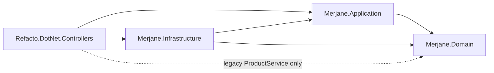

# Merjane order processing (refactoring exercise)

### Consignes .NET: 
* Ignorez les migrations BDD
* Ne pas modifier les classes qui ont un commentaire: `// WARN: Should not be changed during the exercise
`
* Pour lancer les tests: `dotnet test`

---

## 1. Project overview

A small ASP.NET Core API that processes customer orders: for each ordered product it decides whether one unit can be sold, updates the stock and sends the matching customer notification. The legacy controller-centric code was covered by characterization tests, refactored, migrated to .NET 10 and split into four projects, without changing its observable behavior.

## 2. Business context

Merjane sells products online and keeps track of their stock. Every product has a stock (`Available`) and a replenishment lead time in days (`LeadTime`). Processing an order removes one unit of each ordered product, but some products have availability constraints: seasonal products are only sold during their season and expirable products are no longer sold once expired. When a product cannot be sold, customers are notified of a delay, an unavailability or an expiration.

## 3. Tech stack

- .NET 10 (`net10.0`); any .NET 10 SDK (the repository does not pin an SDK version)
- ASP.NET Core 10 controllers, Swashbuckle.AspNetCore 10.3.1 (Swagger UI), Microsoft.AspNetCore.OpenApi 10.0.13
- EF Core 10.0.13 with the InMemory provider
- Tests: xUnit 2.4.2, Moq 4.20.2, Moq.EntityFrameworkCore 7.0.0.2, Microsoft.AspNetCore.Mvc.Testing 10.0.13, coverlet.collector 10.1.0

## 4. Solution architecture

| Project | Main files | Responsibility |
|---|---|---|
| `Merjane.Domain` | `Entities/Product.cs`, `Entities/Order.cs`, `NormalProductRule.cs`, `SeasonalProductRule.cs`, `ExpirableProductRule.cs`, `ProductAvailabilityRules.cs`, `ProductDecision.cs`, `ProductNotification.cs` | Entities and pure availability rules. The current time is a parameter; no EF Core, ASP.NET Core, clock or notification dependency. |
| `Merjane.Application` | `OrderProcessingService.cs`, `ProductDecisionExecutor.cs`, `OrderNotFoundException.cs`, `Ports/IOrderProcessingStore.cs`, `Ports/IProductNotificationPort.cs`, `Ports/IClock.cs` | Order processing use case and the ports it needs. Loads the order, reads the clock once, then for each product sends the notification, updates stock and saves. |
| `Merjane.Infrastructure` | `Persistence/AppDbContext.cs`, `Persistence/EfOrderProcessingStore.cs`, `SystemClock.cs`, `InfrastructureServiceCollectionExtensions.cs` | EF Core InMemory persistence and system clock, registered by `AddInfrastructure()`. |
| `Refacto.DotNet.Controllers` (API) | `Controllers/OrdersController.cs`, `Dtos/Product/ProcessOrderResponse.cs`, `Program.cs`, `Services/Impl/ProductNotificationAdapter.cs`, protected `Services/INotificationService.cs` and `Services/Impl/NotificationService.cs`, legacy `Services/Impl/ProductService.cs` | HTTP endpoint, Swagger and dependency injection composition root. Keeps its original name, assembly and namespaces. |
| `Refacto.Dotnet.Controllers.Tests` | `Domain/`, `Services/`, `Controllers/`, `Architecture/` | Rule unit tests, use case and legacy service tests, HTTP integration tests and layer dependency tests. |

The Domain, Application and Infrastructure projects generate XML documentation files; the API project does not, because its protected files cannot receive XML comments.

**Protected notification adapter.** `INotificationService` and `NotificationService` are marked `// WARN: Should not be changed during the exercise`, so they stay unchanged in the API project. Application declares its own `IProductNotificationPort`, mirroring the three protected methods, and `ProductNotificationAdapter` forwards each call unchanged to `INotificationService`. Notification types, arguments and order are therefore preserved, and Application never references the API.

**Legacy `ProductService`.** It is kept for the existing legacy test scenarios. Its public method names and parameter shapes, including the constructor `(INotificationService, AppDbContext)`, are unchanged, but `Product` and `AppDbContext` moved to the `Merjane.Domain` and `Merjane.Infrastructure` namespaces and assemblies, so source and binary compatibility are not guaranteed for external consumers. It builds its own adapter, `EfOrderProcessingStore` and `SystemClock`, then calls the domain rules and the shared `ProductDecisionExecutor`, so no business rule is duplicated. As a compromise, it depends on concrete Infrastructure types, is not registered in production dependency injection, and is the only reason the API references `Merjane.Domain`. Its removal is deferred technical debt.

## 5. Dependency direction



`Merjane.Domain` references no other project. The tests reference all four projects. `Architecture/LayerDependencyTests` fails if the compiled Domain, Application or Infrastructure assembly references an outer layer, if Domain or Application references EF Core, or if any of them references ASP.NET Core.

## 6. Business rules

Each ordered product is evaluated against the time captured once for the order. Product types match exactly and case-sensitively; any other type leaves the product untouched.

| Type | Sold (stock minus one) when | Otherwise |
|---|---|---|
| `NORMAL` | stock > 0 | lead time > 0: delay notification, stock unchanged. Otherwise nothing happens. |
| `SEASONAL` | stock > 0 and today's date strictly between season start and end | Compared with the current time of day, in this order: replenishment (now + lead time) ending after the season end clears the stock with an out-of-stock notification; a season starting later keeps the stock with an out-of-stock notification; otherwise a delay notification. |
| `EXPIRABLE` | stock > 0 and expiry date strictly after today's date | Stock set to 0 with an expiration notification, even when the product is only out of stock. A missing expiry date throws `InvalidOperationException`. |

Each product is fully handled (notification, stock update, save) before the next one, without a transaction.

## 7. Getting started

Requirements: a .NET 10 SDK. The repository has no `global.json`, so the newest installed SDK is used; any .NET 10 SDK builds it. No database or external service is needed.

Check that a .NET 10 SDK and the ASP.NET Core 10 runtime are installed (look for a `10.x` entry in each list):

```powershell
dotnet --list-sdks
dotnet --list-runtimes
```

```powershell
git clone https://github.com/Strawzer/merjane-refacto-dotnet.git
cd merjane-refacto-dotnet
dotnet restore Refacto.DotNet.Controllers.sln
```

## 8. Build and run

```powershell
dotnet build Refacto.DotNet.Controllers.sln --no-restore
dotnet run --project Refacto.DotNet.Controllers --launch-profile http
```

The `http` profile listens on `http://localhost:5122` in the Development environment and opens Swagger UI at `http://localhost:5122/swagger` (the `https` profile adds `https://localhost:7035`). Swagger is only enabled in Development.

Endpoint: `POST /orders/{orderId}/processOrder`, no request body. On success it returns HTTP 200 with:

```json
{"id":1}
```

The application uses an EF Core in-memory database (`InMemoryDb`) that starts empty and is lost on restart, and no endpoint creates orders. A manual call therefore returns HTTP 500 for any identifier, like an unknown order; the integration tests seed data to exercise the real behavior.

## 9. Running tests

```powershell
dotnet test Refacto.DotNet.Controllers.sln --no-restore
```

76 tests, none of which contacts an external service.

Date handling in tests:

- Domain rule tests pass fixed, deterministic dates to the rules.
- `OrderProcessingServiceTests` and the integration tests replace `IClock` with a mock returning a fixed time (the integration tests override the registration in `WebApplicationFactory`).
- The legacy `ProductServiceTests` are not clock-injected: they build dates from `DateTime.Today`, and `ProductService` reads its own concrete `SystemClock`. Their dates are at least one day away from any boundary, so the risk of a date-dependent failure is low but not zero.

| Test class | Tests |
|---|---|
| `Controllers/OrdersControllerIntegrationTests` (HTTP, `WebApplicationFactory`, InMemory database) | 24 |
| `Domain/SeasonalProductRuleTests` | 18 |
| `Domain/ExpirableProductRuleTests` | 9 |
| `Domain/ProductAvailabilityRulesTests` | 6 |
| `Domain/NormalProductRuleTests` | 4 |
| `Services/OrderProcessingServiceTests` | 6 |
| `Services/ProductServiceTests` | 6 |
| `Architecture/LayerDependencyTests` | 3 |

## 10. Test coverage

Measured with coverlet (`dotnet test --collect:"XPlat Code Coverage"`), which writes a Cobertura report:

- Handwritten code: 96.8% of lines (210/217) and 96.8% of branches (60/62). Domain and Infrastructure are fully covered.
- Uncovered handwritten code: the protected no-op `NotificationService`, which is always mocked; the executor's defensive branch for an unknown notification type; the non-Development branch of `Program.cs`.
- Raw total, including code generated by the Microsoft.AspNetCore.OpenApi source generator: 29.9% of lines. That generated code is not exercised because the application serves Swagger through Swashbuckle.

The handwritten figures exclude the classes of the Cobertura report that belong to the source generator (classes in the `Microsoft.AspNetCore.OpenApi.Generated` namespace and the generated `InterceptsLocationAttribute`, whose names contain `OpenApiXmlCommentSupport_generated`). This filtering was done with a local script that is not part of the repository, so the split is not reproducible from the repository alone; the raw coverlet totals are.

## 11. Behavior-preservation decisions

The refactoring kept the observable behavior, including these surprising cases, because they are covered by characterization tests and changing them would be a business decision rather than a refactoring:

- An unknown order returns HTTP 500, now through `OrderNotFoundException` instead of a `NullReferenceException`.
- Each ordered product removes exactly one unit; orders carry no quantity.
- A `NORMAL` product out of stock with a lead time of 0 sends no notification.
- `SEASONAL` products are not sold on the first or last day of the season, because the season check uses strict comparisons with today's date, while the fallback compares with the current time of day. Missing season dates mean the product is never sold.
- `EXPIRABLE` products expiring later today are still sold; out-of-stock products that are not expired still receive an expiration notification and a stock of 0; a missing expiry date stops the order with `InvalidOperationException`.
- Without a transaction, a failure keeps earlier products saved and leaves later products untouched.
- Products are processed in the order returned by EF Core.

Intentional differences from the original implementation. None of them changes stored data or notifications when processing succeeds:

- Notifications are always sent before the stock update and save. The original delay path (order processing and `ProductService.NotifyDelay`) called `SaveChanges` before sending the delay notification; this difference is deliberately retained. Successful outcomes are equivalent, but the ordering becomes observable in exceptional paths: if the save fails, the notification has already been sent, whereas the original sent none; if the notification fails, nothing is saved, whereas the original had already saved pending changes, such as the lead time set by `ProductService.NotifyDelay`.
- The clock is read once per order instead of several times per product, which only differs for a request running across midnight.
- The explicit `EntityState.Modified` marking of the `NORMAL` branch was dropped; change tracking persists the same values.
- `Console.WriteLine(order)` was removed and `ProductService` is no longer registered in dependency injection.

## 12. Known limitations and technical debt

- Product types are strings; an enum or value object would require an entity change.
- `NotificationService` is a protected no-op stub, so no notification is actually delivered.
- Persistence is in-memory only and there is no endpoint to create orders or products.
- `SystemClock` uses the host's local time.
- Unknown orders return HTTP 500 rather than 404.
- `ProductService` is legacy code depending on concrete Infrastructure types; its removal, together with its unit tests, is deferred.
- Test namespaces mix `Refacto.Dotnet` and `Refacto.DotNet` casing, and test method names use underscores.
- The repository does not bundle any analyzer configuration (no `Directory.Build.props` or `.editorconfig`). In the original development workspace, a parent-folder `Directory.Build.props` outside this repository raises the analysis level and enforces code style, and a parent `.editorconfig` adds style rules; with them, the build reports 65 CA1707 warnings for the underscored test names. A fresh standalone clone builds with the SDK's default analyzers and may not reproduce those warnings.
